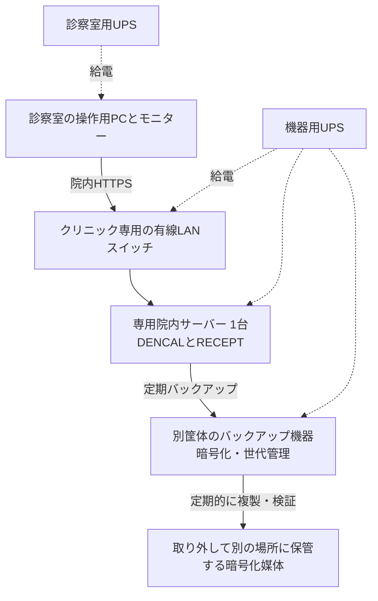
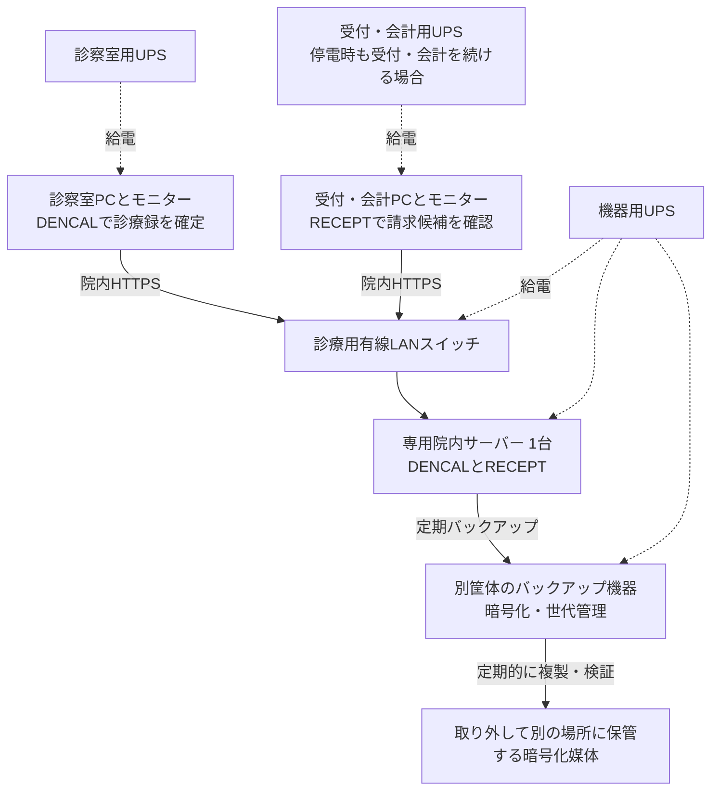
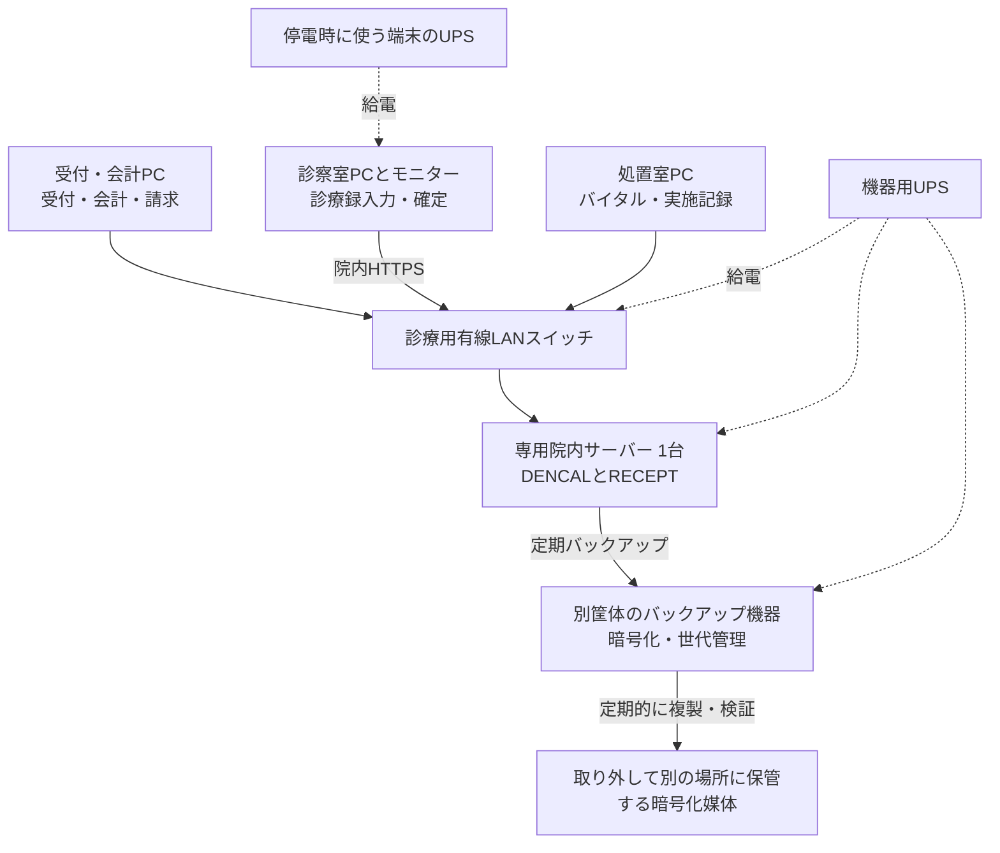

# 院内配備の構成例

DENCALとRECEPTを同じ専用院内サーバーに置き、職員は操作用PCのブラウザーから接続する構成例です。両アプリは個別のSQLiteデータベースをサーバーのローカルストレージに保持し、請求候補はサーバー内APIで連携します。

現行版は架空データを使う試作です。実患者データでの利用に向けて、院内HTTPSでの配備、バックアップの自動化、UPS連動停止を整備し、導入先で検証します。正式な診療報酬算定と電子レセプトの提出は[RECEPTの開発範囲](../README.md#診療報酬の算定とオンライン資格確認)です。

## 1. テナント診療所・操作用PC 1台

医師1人が同じPCで診療録・会計・請求業務を行う想定です。テナントの専有区画に院内機器を置き、建物の非常用電源を利用できない場合を基本とします。

- サーバー、スイッチ、バックアップ機器は施錠できる場所に設置する。診察室までのLAN配線経路、工事の可否、コンセント容量、収納の放熱を確認する。
- ビル共用Wi-Fiや来院者用Wi-Fiと診療用LANを分離する。診療用の名前解決・認証を院内で完結させ、インターネット回線の停止中もカルテを開けるようにする。オンライン資格確認などを利用する場合は、外部サービスの接続経路を別途設計する。

## 2. 医師1人・会計担当1人・操作用PC 2台

診察室では医師がDENCALで診療録を確定し、受付・会計では担当者がRECEPTで請求候補を確認します。操作用PC 2台に加え、専用院内サーバー1台を設置します。

- 会計担当が来院受付も行う場合は、受付・会計PCからDENCALに接続できるようにし、受付に必要な権限を付与する。
- 導入時は、診療録の確定、実施記録の送信、RECEPTでの患者突合、請求候補の確認までを職員ごとのアカウントで検証する。現行のRECEPTでは連携明細の下書き反映と請求確定に医師以上の権限が必要なため、会計担当が行う操作の権限を本番導入前に設計する。

## 3. 受付・診察室・処置室の複数PC構成

受付・会計、診察室、処置室に1台ずつ置く例です。診察室が複数ある場合も、同じ院内サーバーへ接続します。

- 全端末が院内HTTPSで接続し、職員個人のアカウントを使用する。受付・看護・診療・会計の操作範囲を決め、受付から請求候補の受け渡しまで通して確認する。
- 図では診察室PCを停電時の優先端末とする。受付も継続する場合は受付・会計PCとモニターに給電する。通信経路上の追加スイッチやルーターも給電対象に含める。
- サーバーや共用スイッチの故障は全端末に影響する。予備スイッチへの交換と、代替サーバーへの復元の手順を用意する。

## バックアップ・停電・復旧

| 項目 | 構成・運用 |
| --- | --- |
| 定期バックアップ | 両アプリのDB、構成情報、監査ログを別筐体へ保存する。アプリが提供するDB書き出し手順を使い、取得時刻・連携履歴を記録する。署名を使う場合は過去の署名の検証に必要な証跡・証明書も保存する。 |
| オフライン保管 | 暗号化した交換媒体への複製を検証し、機器から切り離して別の場所に保管する。 |
| 短時間の停電 | UPSでサーバー、必要なネットワーク機器、バックアップ機器、優先端末に給電する。施設の非常用電源を使える場合は、対象コンセントと切替時の動作を現地で確認する。 |
| 長時間の停電 | 紙運用に切り替える。UPSの残量が尽きる前に、サーバーとバックアップ機器を正常停止する。給電時間は機器の実測負荷と正常停止に必要な時間から決める。 |
| 復電・故障からの復旧 | ネットワーク、サーバー、両アプリの順に稼働を確認する。必要に応じて代替サーバーに復元し、診療録・訂正履歴の参照、紙記録の転記、請求候補の未反映や重複の照合を済ませてから連携を再開する。 |

## 導入時の確認

- 架空データを使い、インターネット回線を切った状態で院内端末からカルテを開いて保存できることを確認する。
- 複数端末で同一受診の同時編集、受付の重複登録、請求候補の再送を試験する。
- 停電を想定し、優先端末からの保存、UPS連動停止、復電後の再開までを確認する。
- オフライン媒体から代替サーバーへ両アプリを復元し、カルテの閲覧・印刷と請求候補の照合を確認する。

[厚労省ガイドライン第7.0版への対応状況](mhlw-guideline-status.md) · [DENCAL連携設計](dencal-integration.md) · [RECEPTのバックアップと復元手順](backup-recovery.md)
